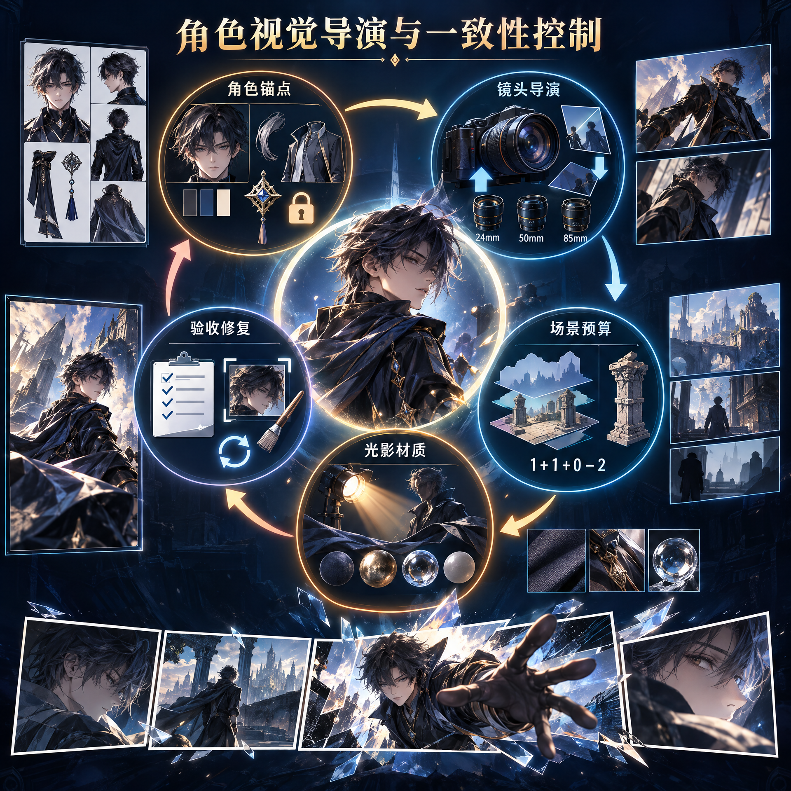

# 角色视觉导演与一致性控制

> 告别“平视站桩、完美假笑、塑料皮肤、背景贴图感与道具堆砌”。这不是一份继续堆关键词的提示词清单，而是一套把图像模型当作摄影团队来指挥的**角色视觉导演工作流**。

[立即下载完整 Skill](https://github.com/tingting-CY/character-visual-direction-skill/archive/refs/heads/main.zip) · [查看核心规则](./SKILL.md) · [从快速应用开始](#下载与应用)



## 为什么需要这个 Skill

许多角色图的问题并非“模型不会画”，而是没有被给出足够明确的导演决策。只写“一个酷女孩在雨夜城市”时，模型通常会选择最安全、最常见的答案：角色居中、平视、表情标准化、人物与背景各自打光、所有东西同样清晰且同样光滑。

这个 Skill 将创作重点从“描述画面里有什么”转为“**决定观众先看什么、角色为何在此刻行动、空间与光线如何证明这一切真实发生**”。它将视觉控制拆为可复用的模块：角色锚点、镜头参数、叙事锚点、场景预算、光影/动力/材质/构图契约，以及验收与最小修复。

| 常见默认出图 | 使用 Skill 后的控制方式 |
|---|---|
| 平视居中、全身站立，像证件照 | 用景别、机位、Pitch、Yaw、Roll、焦段与主体位置建立明确的观看关系 |
| 九宫格或多图里角色不断换脸、换服装 | 先锁定角色基准图、固定项与本轮变量；每次只改变 1–2 项 |
| 雨夜、霓虹、道具、人群全部堆在同一张图 | 用“1 个主体 + 1 个叙事锚点 + 0–2 组支持元素”控制场景密度 |
| 人物是影棚柔光，背景却是霓虹夜景 | 用主光、阴影、环境反射与接触遮蔽组成可验证的光线契约 |
| 动作像悬浮木偶，衣服与道具没有反馈 | 指定支撑点、重心、力量方向、反作用和拖尾 |
| 每种表面都像同一种塑料 | 为关键材质赋予不同的粗糙度、纹理、高光、反射或透光方式 |

## 为什么值得下载并应用

下载这个 Skill，不是获得一条“万能神 Prompt”，而是获得一套可迁移到不同角色、不同图像平台和不同团队协作流程中的判断框架。

| 获得内容 | 可以直接解决的问题 |
|---|---|
| **角色一致性控制** | 为角色设定图、连续剧情图和多场景变体建立固定项、变量与基准图策略 |
| **经典摄影参数** | 用低机位、俯视、肩后、荷兰角、透视缩短、鱼眼及 14–135mm 全画幅等效焦段表达明确镜头意图 |
| **场景元素预算** | 用减法、元素组合并、前中后景与叙事锚点消除“元素打架” |
| **画面自洽诊断** | 从光线、表情、动力、材质、构图五项契约定位“很 AI”的真正根因 |
| **漫画叙事布局** | 使用非均分四宫格、镜头递进、主角破格/越框，不再局限于 2×2 排版 |
| **平台适配与修复流程** | 在参考图、姿态控制、深度控制、局部重绘或仅文本生成之间选择恰当路径 |

**推荐下载应用给以下创作者与团队：**

- 想让 AI 角色从“好看”进阶到“有故事、有镜头、有真实空间感”的插画师、设计师与 AIGC 创作者；
- 需要稳定扩展角色资产的游戏、美术、品牌 IP、小说和漫画团队；
- 经常生成海报、封面、立绘、分镜、角色设定页或社交媒体角色主视觉的内容团队；
- 已有图像模型或工作流，但总是收到“太 AI、太塑料、人物贴背景、没有重点”反馈的项目负责人。

## 下载与应用

### 方式一：下载完整目录（推荐）

点击 [下载 ZIP](https://github.com/tingting-CY/character-visual-direction-skill/archive/refs/heads/main.zip)，解压后保留 `SKILL.md`、`references/` 和 `assets/` 的目录关系。不要只单独复制 `SKILL.md`，因为镜头参数、漫画布局与画面自洽诊断均位于 `references/` 中。

也可使用 Git：

```bash
git clone https://github.com/tingting-CY/character-visual-direction-skill.git
```

### 方式二：导入支持 Skill 的智能体或创作环境

将下载后的完整目录作为一个 Skill 导入支持 `SKILL.md` 的智能体平台或团队知识库。首次使用时，让智能体读取 `SKILL.md`；只有需要下列专项能力时，再读取对应参考文件：

| 需要完成的任务 | 读取文件 |
|---|---|
| 相机高度、镜头角度、焦段与透视验证 | `references/camera-prompt-examples.md` |
| 非均分四宫格、主角越框、逐格拼版 | `references/comic-panel-layouts.md` |
| 解决贴图感、假笑、塑料材质、木偶动作与居中惯性 | `references/realism-and-coherence-control.md` |

### 方式三：立刻开始一次角色视觉导演任务

将以下需求结构交给已加载 Skill 的智能体。它会先建立可控方案，再输出平台适配的主 Prompt、修复重点与验收标准：

```text
请使用“角色视觉导演与一致性控制”Skill，为以下需求制定角色视觉方案：

任务类型：单张主视觉 / 多图变体 / 四宫格漫画 / 局部修复
角色锚点：
固定项：
本轮只变化：
叙事时刻与目标情绪：
场景复杂度：极简 / 标准 / 丰富
目标画幅与平台：
```

> **推荐起点**：若要做同角色系列图，先用 Skill 创建并确认“角色基准图”，再扩展到雨夜、追逐、战斗、情绪特写、九宫格或漫画页。不要从一个包含大量道具、极端机位和复杂动作的场景直接开始。

## 目录

- [为什么需要这个 Skill](#为什么需要这个-skill)
- [为什么值得下载并应用](#为什么值得下载并应用)
- [下载与应用](#下载与应用)
- [它解决什么问题](#它解决什么问题)
- [适用范围](#适用范围)
- [核心概念](#核心概念)
- [快速开始](#快速开始)
- [输入 Brief 模板](#输入-brief-模板)
- [标准工作流](#标准工作流)
- [画面自洽与反塑料控制](#画面自洽与反塑料控制)
- [漫画分镜与非均分四宫格](#漫画分镜与非均分四宫格)
- [场景复杂度控制](#场景复杂度控制)
- [提示词组织方式](#提示词组织方式)
- [平台与工具适配](#平台与工具适配)
- [质量验收与修复](#质量验收与修复)
- [典型使用示例](#典型使用示例)
- [团队协作约定](#团队协作约定)
- [仓库结构与维护](#仓库结构与维护)
- [限制与常见误区](#限制与常见误区)

## 它解决什么问题

角色图像生成通常不缺“元素”，而缺少**取舍、结构与一致性控制**。本技能重点处理以下问题：

| 常见问题 | 技能的处理方式 |
|---|---|
| 角色平视站立、画面像证件照 | 通过机位、景别、动作动机、视线和空间关系建立导演意图 |
| 多图中脸、发型、服装不断变化 | 先建立角色基准图，明确固定项与变量，并按小步迭代扩展 |
| 人物像贴在背景上 | 补齐接触点、前中后景、投影、环境反光和景深逻辑 |
| 场景中道具与关键词越写越多 | 用“场景元素预算”和“叙事锚点”代替元素罗列 |
| 背景比角色更抢眼 | 用焦点、光比、色彩、景深、留白和信息密度重新排序 |
| 角色动作僵硬、没有重量感 | 以行动动机、重心、惯性、衣发受力和地面反馈描述动作 |
| 皮肤、布料、金属都像塑料 | 针对关键材质描述粗糙度、微纹理、高光和环境反射差异 |
| 人物与背景像硬贴图、表情像默认假笑、画面整体“很 AI” | 通过光线、表情、动力、材质、构图五项契约逐项定位根因并最小化修复 |
| 一次生成九宫格时人物不稳定 | 区分“设定九宫格”与“导演探索九宫格”，优先逐格生成后排版 |
| 四宫格漫画变成死板 2×2 或四格内容重复 | 先定义阅读动线、格子面积权重和四个叙事节拍，再选择非均分布局 |

## 适用范围

### 适合使用

- 原创角色、游戏角色、小说角色、虚拟人或 IP 角色的视觉设计。
- 角色设定图、三视图、服装设计展示、基准角色图。
- 同一角色在不同情绪、动作、镜头和场景中的系列变体。
- 海报、封面、游戏立绘、社交媒体主视觉、剧情瞬间。
- 一页四格漫画、非均分漫画页、角色分镜探索与逐格生成后的拼版。
- 基于已有角色图进行镜头扩展、场景扩展、局部重绘或问题修复。
- 需要对图像生成提示词进行诊断、重写、精简或平台适配的任务。

### 不适合使用

- 无角色主体的纯风景图。
- 仅关注商品陈列、参数准确性或商业电商规范的产品图。
- 与图像生成无关的文案、翻译、图片压缩或格式转换。
- 需要严格工程尺寸、测量精度或可制造性的技术制图。

## 核心概念

### 1. 角色锚点

角色锚点是跨图保持不变的身份信息。应优先锁定以下内容：

- 年龄段、脸型、肤色、瞳色、发型轮廓。
- 固定服装版型、主色、标志性图案和配饰。
- 物种、体型、关键伤痕、特征性妆容或非人类设定。
- 媒介和风格锚点，例如电影写实、赛璐璐、低多边形 3D 或油画。

> **原则**：先回答“角色是谁”，再回答“角色在做什么”。复杂剧情、强透视和丰富场景应建立在已确认的基准角色图之上。

### 2. 固定项与变量

每一轮创作都应区分不可变更内容和本轮探索内容：

| 类别 | 固定项示例 | 变量示例 |
|---|---|---|
| 身份 | 脸型、发型、瞳色、年龄段 | 表情、视线、轻微妆容 |
| 服装 | 主服装版型、主色、配饰 | 褶皱、受风方向、磨损、局部反光 |
| 叙事 | 角色身份、人物动机、情绪基调 | 动作、镜头、场景、道具 |
| 风格 | 渲染方式、整体色彩语言 | 时间段色温、局部色光、颗粒度 |
| 技术 | 基准图、身份保持能力、目标画幅 | 单图构图、景别、背景复杂度 |

单轮最多改变 **1–2 个主要变量**。例如，先改变“情绪 + 视线”，再改变“镜头 + 场景”；不要同时改变脸、服装、年代、风格、动作和机位。

### 3. 角色基准图

基准图是多图一致性的起点。它应使用中性光、干净背景、稳定姿态和低透视，清楚呈现：

- 面部与发型；
- 服装结构和配饰；
- 身体比例与轮廓；
- 已确认的画风和渲染方式。

多图任务中，优先将该图作为共同参考。文本描述、种子或随机参数可以辅助迭代，但**不能单独保证角色绝对一致**。

### 4. 叙事锚点

叙事锚点是角色正在接触、注视或回应的对象/地点，用于解释动作和情绪。

- 角色握着旧信：信是锚点，支持“克制悲伤”或“等待消息”。
- 角色靠在雨夜站台栏杆上：栏杆或站台是锚点，支持“离别”或“犹豫”。
- 角色望向窗外：窗是锚点，支持“远望、孤独或期待”。

与角色没有互动、不能解释场景或不引导视线的物件，默认不应写成清晰前景。

## 快速开始

1. **选择任务类型**：角色设定、单张主视觉、多图变体、九宫格或局部修复。
2. **提供角色锚点**：给出角色描述或已有基准图；明确绝不可变化的内容。
3. **说明本轮变量**：只选择少量需要变化的动作、镜头、情绪或场景。
4. **设定场景复杂度**：选择极简、标准或丰富，并指定必须保留的叙事锚点。
5. **指定目标平台和用途**：说明是否支持参考图、局部编辑、姿态控制，以及最终画幅和文案留白。
6. **按验收清单评估结果**：先看角色身份和物理逻辑，再看情绪与风格；只修复出错的最小区域。

技能主体请见：[SKILL.md](./SKILL.md)。其中包含完整的触发条件、决策规则、提示词模块、平台适配与修复策略。

## 输入 Brief 模板

团队成员可直接复制以下模板发起需求：

```text
任务类型：角色基准图 / 角色设定图 / 单张主视觉 / 多图变体 / 九宫格 / 局部修复
目标用途：例如游戏角色卡、活动海报、小说封面、社交媒体配图
目标平台：例如支持参考图的图像模型、扩散工作流、局部编辑工具；未知可留空
画幅与留白：横/竖/方；角色位置；是否为标题或 UI 留出空间

角色锚点：
- 身份与外观：
- 固定服装/配饰：
- 绝不可变化项：
- 风格锚点：
- 基准图 / 参考图：

本轮变量：
- 动作与情绪：
- 镜头：
- 场景与交互：
- 场景复杂度：极简 / 标准 / 丰富
- 必须保留的叙事锚点：
- 光影与色彩：
```

### 最小可用 Brief

信息有限时，至少提供下列三项：

```text
1. 任务类型与用途。
2. 角色锚点（文字或参考图）。
3. 本轮只想改变的一个目标，例如“让她在雨夜车站表现克制的告别”。
```

未提供的低风险信息可使用技能默认值：一个主光源、一个视觉焦点、中等以下场景复杂度、一个明确动作，以及不直视镜头的自然视线。

## 标准工作流

### 阶段 1：判断交付目标

| 类型 | 主要目标 | 推荐方式 | 避免事项 |
|---|---|---|---|
| 角色设定图 / 三视图 | 展示比例、服装与结构 | 中性光、简背景、稳定姿态、低透视 | 鱼眼、强荷兰角、强景深和复杂剧情背景 |
| 单张主视觉 | 戏剧张力与叙事冲击 | 一个明确镜头、动作、锚点和主光源 | 同时堆叠多个镜头手法或情绪 |
| 同角色多图变体 | 人物识别稳定、有限变化 | 参考同一基准图，逐张生成，每轮只改变 1–2 项 | 一次跨越年代、服装、风格、场景和机位 |
| 设定九宫格 | 确认角色资产 | 统一背景、服装、光线，仅温和变化姿态和景别 | 复杂背景、极端镜头和强戏剧光 |
| 导演探索九宫格 | 探索情绪与镜头范围 | 九格独立生成，再统一排版 | 期待一张生成式九宫格的脸部完全一致 |
| 漫画分镜页 / 非均分四宫格 | 用格子面积、阅读动线和镜头递进讲清一个转折 | 先选布局与四个叙事节拍；高要求时逐格生成后拼版 | 死板 2×2、每格同景别、要求 AI 生成可读对白或跨格绝对一致 |
| 局部修复 | 保留原图，修正少量问题 | 继承原镜头、光线、色彩和角色身份 | 用全新提示词重做整张图 |

### 阶段 2：先锁定角色，再设计画面

1. 创建或确认角色基准图。
2. 列出固定项与允许变化项。
3. 为本轮选择一个主要镜头方案、一个动作意图、一个主光源、一个视觉焦点和一个场景元素预算。
4. 组装提示词并生成简版。
5. 按身份、姿态、空间、光影、材质、构图和场景密度验收。
6. 用局部重绘或小范围变体修复失败项；不要不断给同一提示词追加无关形容词。

## 画面自洽与反塑料控制

当反馈停留在“很 AI”“像拼贴”“假笑”“塑料感”“像悬浮木偶”或“像证件照”时，不要继续追加 `cinematic`、`realistic`、`masterpiece` 等泛化词。先完成以下五项契约，并只修复最早发现的一个根因：

| 契约 | 要回答的问题 | 可观察的验收信号 |
|---|---|---|
| 光线 | 主光从哪里来？影子和反射往哪里去？ | 人、道具、背景的亮暗、投影和环境色一致 |
| 表情 | 什么事件引发情绪？眼、口、下颌、肩手如何共同表现？ | 即使不看嘴角，也能读出角色的主情绪 |
| 动力 | 重量由哪里支撑？重心、力量和衣发拖尾朝哪边？ | 可指出支撑点、力量方向与地面/道具反馈 |
| 材质 | 哪 2–4 种材料最关键？各自怎样吸光、反光或磨损？ | 皮肤、布料、金属、玻璃不再具有相同的“塑料”受光方式 |
| 构图 | 角色在哪里、看向哪里、留白为何存在？ | 偏心构图、负空间和对重元素均服务叙事，而非随机裁切 |

**修复优先级**：身份 → 姿态/重心 → 光线/空间 → 构图 → 材质 → 微瑕疵。脸和服装已经漂移时，不应先处理胶片颗粒、灰尘或皮肤纹理。

完整的诊断表、正向 Prompt 骨架、局部修复模板、平台能力分流和反例见：[画面自洽与反塑料控制参考](./references/realism-and-coherence-control.md)。

## 漫画分镜与非均分四宫格

四宫格的目标不是“让模型画四个小画面”，而是让一页承担一个明确转折。页面规划先于 Prompt：确定**阅读方向 → 页级事件 → 建立/触发/动作/反应四个节拍 → 格子面积权重 → 每格镜头职责**。

| 布局 | 结构 | 适用节奏 |
|---|---|---|
| `L01` 锚点瀑布式 | 上方宽格 + 下方左侧竖格 + 右侧上下两个小格（`1 + 1 + 2`） | 建立地点 → 行动 → 触发细节 → 情绪落点 |
| `L02` 纵向压迫式 | 左侧全高竖格 + 右侧三个横向小格（`1 + 3`） | 巨大空间或持续压迫，右侧连续推进时间 |
| `L03` 反转阶梯式 | 上方两个不等格 + 下方宽格 + 窄竖格（`2 + 1 + 1`） | 发现 → 意识 → 动作/转折 → 悬念余韵 |
| `L04` 中心爆发式 | 中央大动作格 + 三个嵌入小格（`1 + 3 inset`） | 动作爆发、逃离、坠落、魔法或临界选择 |

### 生产规则

- 明确写出 `exactly four distinct bordered panels, asymmetrical layout, not a 2 by 2 grid`，并在 Prompt 中说明 P1–P4 的位置、大小、镜头和事件。
- 四格至少包含一格环境/空间、一格动作或转折、一格信息特写，以及一格反应或余韵；不要生成四张同样的中景站桩图。
- 原生单页生成仅适合验证概念节奏；需要**精确格线、人物一致性、复杂连续动作或可编辑对白**时，优先逐格生成后拼版。
- 不要求图像模型生成可读文字。使用 `no text, no speech bubbles, no captions`，在低细节留白区后期叠加气泡和台词。
- 每格重置元素预算：角色或物件 + 1 个叙事锚点 + 0–1 组支持元素。不要让每一格都塞满完整城市和特效。
- 需要主角**破格 / 越框**时，只让一个来自起源格的连续元素（头肩、前手、武器或披风）跨越边框和 `gutter` 的约 `10–20%`；保留格线、保护邻格焦点，并且一页只使用一次。

完整布局坐标、单页与逐格 Prompt 骨架、三套实际测试 Prompt、破格 Prompt 与验收表见：[漫画分镜与非均分四宫格参考](./references/comic-panel-layouts.md)。

## 场景复杂度控制

### 默认预算：`1 + 1 + 0–2`

这是本技能控制“元素堆积”的默认规则：

- **1 个角色主体**：画面的唯一或第一视觉焦点。
- **1 个叙事锚点**：角色正在接触、注视或回应的物品/地点。
- **0–2 组支持性元素**：说明地点、尺度、路径或前后景；将同类物品合并成一个环境组。
- **氛围层**：用光线、天气、景深、色彩分级或材质统一情绪；它不是额外的道具清单。

| 场景等级 | 适用场合 | 推荐预算 | 示例 |
|---|---|---|---|
| 极简 | 设定图、封面、情绪肖像 | 主体 + 0–1 个锚点 | 角色站在窗边，室内仅保留一扇窗 |
| 标准 | 游戏立绘、单人主视觉、叙事瞬间 | 主体 + 1 个锚点 + 1–2 组支持元素 | 角色握车票站在空站台，背景仅有失焦铁轨和一块远处指示牌 |
| 丰富 | 群像、世界观关键画面、剧情海报 | 主体 + 1 个锚点 + 最多 3 组支持元素 | 先锁定前/中/后景，每组只承担一个叙事功能 |

没有明确的群像或世界观需求时，不使用“丰富”级别。

### 元素筛选问题

在把一个元素写入提示词前，逐项确认：

1. 它是否解释角色正在做什么？
2. 它是否说明角色在哪里？
3. 它是否解释角色为什么产生此刻情绪？
4. 它是否把视线引导到角色或叙事锚点？

四项皆否时，删除、合并、置入失焦背景或留到下一张图。不要把场景当作关键词容器。

### 合并与减法示例

| 元素堆积写法 | 推荐改写 | 原因 |
|---|---|---|
| 霓虹招牌、广告屏、汽车、人群、摊贩、灯笼、雨棚、路牌、街边屏幕 | `distant defocused neon market street` | 将重复表达“繁忙夜市”的物品收束为一个背景环境组 |
| 火车、车票、行李箱、月台、时钟、雨伞、告别信 | 选择“站台 + 手中的车票”或“车窗 + 行李箱” | “离别”只需一个强锚点和一个空间提示 |
| 闪电、乌鸦、破伞、霓虹广告、雨棚、人群、车辆、浓雾 | `cold rainy night, wet pavement reflections, cyan side light` | 光、天气与反射可以承担氛围，不必添加同义道具 |

### 分层生成顺序

复杂场景分层生成，而不是在第一条提示词中塞进所有细节：

1. 先生成“角色 + 叙事锚点 + 主光源”，确认角色、动作、空间方向和焦点。
2. 加入一组空间支持元素，确认不遮挡角色、不抢焦点、不破坏光线逻辑。
3. 最后只加入一类主氛围处理，例如雨、雾、尘、景深或色彩分级。
4. 将未采用的世界观元素迁移到同一系列的下一张图、道具特写或背景扩展图。

如果目标平台支持排除指令，可附加以下约束：

```text
restrained set dressing, only the specified props, uncluttered background, clear focal hierarchy, no unrelated decorative objects
```

## 提示词组织方式

### 模块化顺序

提示词按下列顺序组织；删除无关模块，不要把整个词库机械拼接：

```text
[创作目标与媒介]
[角色锁定：身份、脸部/发型、服装、标志性特征]
[镜头：景别 + 机位 + 视角]
[动作与情绪：动作动机 + 身体受力/动态反馈]
[场景关系：接触点 + 前中后景 + 遮挡]
[场景元素预算：叙事锚点 + 至多 0–2 组支持元素 + 氛围处理]
[构图：主体位置 + 焦点 + 留白]
[光影：主光源方向 + 色温 + 阴影/反光]
[材质与风格：关键表面与渲染特征]
[平台支持时的约束或避免项]
```

### 关键写法

- 用可观察的因果关系代替抽象形容词。写 `daylight from the left window, long shadows cast to the right`，不要只写 `cinematic lighting`。
- 用“情绪 + 诱因 + 可见行为”代替孤立表情词。写“握紧旧信、低头、肩膀收拢”，不要只写“悲伤”。
- 每张图只选一个主要镜头方案。不要将三视图、鱼眼、鸟瞰、微距和荷兰角堆叠到同一单图。
- 让角色与场景有至少一个可信接触点：脚踩地面、背靠墙、手握物件、衣物受风或身体投影。
- 只选择 2–4 种叙事相关的关键材质。让皮肤、布料、金属、玻璃或陶瓷具有不同的粗糙度、纹理和高光。

### 叙事主视觉模板

```text
A cinematic character key visual of [角色核心描述], retaining [固定身份、发型、服装与配饰锚点].
[景别] from a [机位], [有动机的动作], [主情绪与视线].
[角色与场景的接触关系]; narrative anchor: [1 个锚点]; support groups: [至多 0–2 组]; foreground [前景], character in the midground as the primary focal point, background [背景与景深].
[主光源] from [方向] with [色温], [投影/反光逻辑], [2–4 种关键材质].
[画风] with [色彩与氛围], clear visual hierarchy, [留白位置（如需要）].
```

## 平台与工具适配

先确认当前平台能力，再建议对应方法。不要把某一种扩散工作流能力当成所有工具的通用功能。

| 平台能力 | 推荐做法 | 注意事项 |
|---|---|---|
| 支持角色参考图或身份保持 | 将确认过的基准图作为每张变体的共同参考；文本只描述本轮变量 | 先小范围改变表情、视线、姿态，再扩展场景和镜头 |
| 支持姿态控制 / OpenPose | 用于动作戏、舞蹈、高风险姿势和复杂肢体关系 | 先锁定骨架，再补服装、表情和环境 |
| 支持深度 / Depth | 用于强透视、俯仰视角和复杂空间层级 | 提高近大远小和空间稳定性，但不承诺逐像素复刻 |
| 支持线稿、边缘或构图参考 | 用于服装轮廓、建筑线条或明确构图 | 防止约束过强而使画面失去自然变化 |
| 支持局部重绘 | 修复手部、面部、光影、材质、边缘和局部穿模 | 必须继承原图镜头、光线、色彩与透视 |
| 已有 LoRA 或角色模型 | 作为稳定角色资产或画风资产 | 不是每次生成的必经步骤 |
| 不支持上述能力 | 简化动作和透视；逐步编辑或小范围变体 | 说明可控性限制，不承诺完美复制或绝对一致 |

## 质量验收与修复

每轮生成后，先修复影响识别和叙事的错误，再处理氛围微调。

| 维度 | 通过标准 | 常见失败 | 建议修复 |
|---|---|---|---|
| 身份一致性 | 脸、发型、服装标志物和年龄段一致 | 换脸、服装漂移、比例或年龄漂移 | 回到基准图或身份锚点，不要继续追加形容词 |
| 姿态物理 | 重心、脚部接触、手部关系和衣发受力合理 | 悬浮、穿模、多余肢体、错误透视 | 局部重绘或简化动作；必要时使用姿态控制 |
| 空间关系 | 接触点、遮挡、景深和透视统一 | 人物贴背景、地面关系错误 | 校正接触阴影、反光、遮挡与景深 |
| 光影逻辑 | 主光方向、阴影方向和环境色一致 | 人物与背景光源相反、无来源高光 | 先锁定主光，再修人物或背景的一侧 |
| 材质区分 | 关键表面有清楚差异 | 皮肤、布料、金属全部像塑料 | 强化粗糙度、纹理、反射和微瑕疵差异 |
| 构图层级 | 角色或叙事动作是明确焦点 | 背景抢戏、没有留白、人物无意图居中 | 降低背景细节和对比，强化光比、景深或引导线 |
| 场景密度 | 元素有功能且不超预算 | 道具堆积、重复表达地点、粒子效果泛滥 | 删除纯装饰项、合并为环境组、转移到下一张图 |
| 叙事清晰度 | 能读出角色在做什么及其基本情绪 | 表情与动作矛盾、道具无意义 | 缩减动作或道具，重新说明行动动机 |

## 典型使用示例

### 示例 1：先创建角色基准图

**需求**：为一名未来城市快递员建立后续系列图通用的角色锚点。

```text
任务类型：角色基准图
目标用途：游戏角色卡与后续多场景变体
角色锚点：20 多岁女性，短黑发，一侧银色发夹，琥珀色眼睛，深蓝短夹克、橙色快递包、左手腕有旧式通信器
固定项：发夹、夹克主色、快递包、通信器
风格：半写实科幻电影概念设计
画幅：竖版 4:5
```

**执行重点**：使用中性柔光、干净背景、平视三分之四中全身、放松站姿；不要先加入飞行车、广告屏、追逐动作或雨夜霓虹。

### 示例 2：将基准角色扩展为叙事主视觉

**需求**：让同一角色在雨夜站台表现收到坏消息后的克制情绪。

```text
任务类型：单张角色主视觉
固定项：沿用已确认的未来城市快递员基准图
本轮变量：低头看着通信器，克制悲伤；微俯视中景
场景复杂度：标准
叙事锚点：手中的通信器
支持元素：失焦铁轨、远处单块站台指示牌
光影：左侧冷蓝站台灯；右后方微弱暖色列车光；湿地反射
画幅：竖版 4:5，顶部留出标题空间
```

**关键取舍**：雨、湿地反射和冷蓝侧光已足以服务情绪；不再添加广告屏、人群、车辆、乌鸦、闪电、雨伞、多个招牌等同义元素。

### 示例 3：修复“人物贴背景”

**问题**：角色站在雨夜街道中，但脚部漂浮、影子方向与路灯冲突，衣服没有环境色。

**局部编辑要求**：

```text
Preserve the original character identity, pose, clothing, camera angle, and composition.
Repair only the feet and lower coat: place both boots firmly on the wet pavement, add soft contact shadows matching the streetlight direction, and add subtle cyan reflections from the wet ground to the lower coat.
Do not alter the face, hairstyle, upper body, or background layout.
```

**验收重点**：脚与地面连接、阴影方向、湿地反光、角色与背景的色温是否统一。

## 团队协作约定

### 角色资产负责人

- 负责角色基准图、固定项清单和已确认参考图。
- 每次更新角色锚点时，记录原因与影响范围。
- 未经确认，不将角色基准图中的脸、主服装或标志性配饰视为可变项。

### 视觉导演 / 提示词负责人

- 为每张图明确一个主镜头、动作意图、主光源、视觉焦点和场景预算。
- 优先用叙事锚点与空间关系讲故事，不用大量装饰性名词堆画面。
- 在交付中写明相对基准图改变的变量，以及平台相关的可控性限制。

### 审稿 / 质量负责人

- 使用“身份、物理、空间、光影、材质、构图、场景密度、叙事”八项清单审查。
- 反馈应指向可修复的画面问题，例如“删除右侧亮招牌并将铁轨退为失焦背景”，而不是只写“画面不高级”。
- 区分“保留为下一张图的世界观信息”和“本张图需要删除的干扰信息”。

### 评审记录建议

对每张被确认的图记录：

```text
图号 / 版本：
角色基准版本：
固定项：
本轮变量：
场景预算：
使用的平台与控制能力：
通过项：
待修复项：
下一轮仅改变：
```

## 仓库结构与维护

```text
.
├── README.md    # 面向团队成员的使用说明（本文件）
└── SKILL.md     # 供 AI 读取和执行的技能主体；唯一行为规范来源
```

- `SKILL.md` 是技能行为的**唯一事实来源**。新增规则、触发条件、输出格式和验收标准时，必须首先更新该文件。
- `README.md` 面向人类协作者，说明用途、流程与案例；不要将 README 复制进安装后的 Skill 目录或把它当作执行规则。
- 修改 `SKILL.md` 后，应运行以下校验：

```bash
python /home/ubuntu/skills/skill-creator/scripts/quick_validate.py /path/to/character-visual-direction
```

- 提交前请确认：技能描述仍然包含“做什么”和“何时触发”；无遗留 TODO；正文不超过约 500 行；示例与技能规则没有冲突。

### 建议提交方式

| 修改类型 | 示例提交信息 |
|---|---|
| 新增能力 | `feat: add scene complexity budget` |
| 修正行为或规则 | `fix: clarify character baseline workflow` |
| 优化文档 | `docs: expand team usage guide` |
| 调整示例 | `docs: refine cinematic prompt examples` |

## 限制与常见误区

- **不要承诺绝对角色一致性**：仅靠文本提示词无法稳定锁定同一张脸、服装和比例。多图任务优先使用基准图或平台的身份保持能力。
- **不要混用相互冲突的镜头语言**：三视图、鱼眼、极端广角、鸟瞰全景和微距脸部特写通常不属于同一单图方案。
- **不要让工具名替代创作判断**：ControlNet、LoRA、种子、负面提示词和局部重绘只在平台支持且问题确实需要时使用。
- **不要把“更多元素”误当成“更丰富”**：丰富来自层级、取舍、光影和叙事关系，而非道具数量。
- **不要把“真实感”当作唯一标准**：风格化、动画、漫画和超现实作品可以夸张，但应在各自画风中保持角色、空间和光影的自洽。

---

如需执行规范、完整提示词模板、镜头词库、九宫格策略或平台适配细节，请阅读 [SKILL.md](./SKILL.md)。
